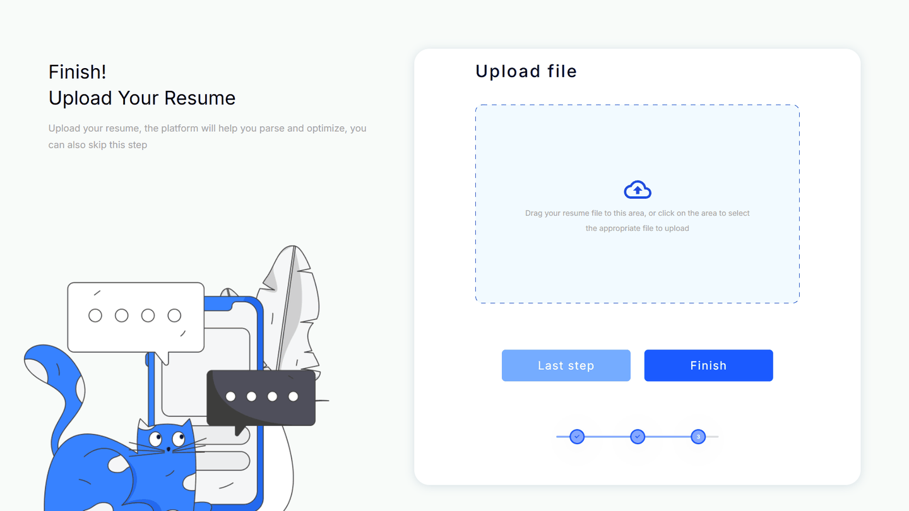
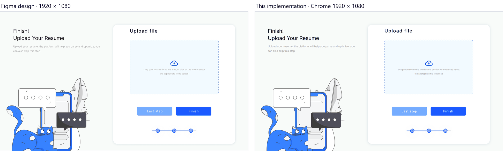
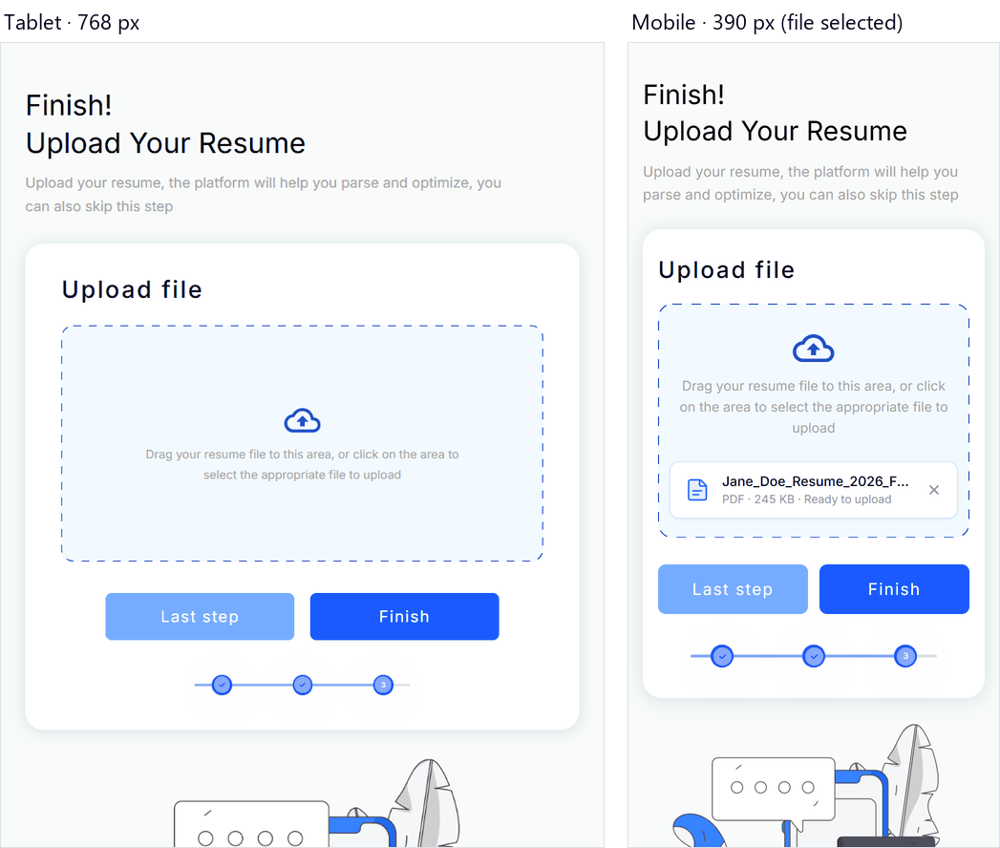
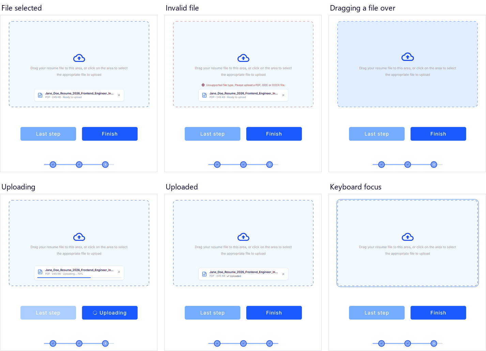

# Upload Your Resume

[](https://github.com/yklq44/d5data-frontend-assessment/actions/workflows/ci.yml)

A pixel-accurate, responsive and accessible implementation of the “Upload Your Resume” page from the [front-end assessment design](https://www.figma.com/design/D0jjN7Twkq0DGm3ZJvQabz/%E5%89%8D%E7%AB%AF%E5%B7%A5%E7%A8%8B%E5%B8%88%EF%BC%88%E5%AE%9E%E4%B9%A0%EF%BC%89?node-id=0-1&p=f), built with React 19, TypeScript and Vite.

**Live demo: <https://yklq44.github.io/d5data-frontend-assessment/>**



## Getting started

Requires Node.js 20.19 or later.

```bash
npm ci
npm run dev        # dev server on http://localhost:5173
npm test           # unit and component tests (Vitest + Testing Library)
npm run test:e2e   # end-to-end tests in Chrome (Playwright), run against the production build
npm run lint       # oxlint, including the jsx-a11y rules
npm run build      # type-check and build into dist/
```

The end-to-end tests use the Google Chrome installed on the machine. Without Chrome, run `npx playwright install chromium` and remove `channel: 'chrome'` from `playwright.config.ts`.

## Assessment checklist

### Requirements

- **Layout and structure.** A CSS grid reproduces the 1920 × 1080 frame: the intro text at the top left, the upload card on the right and the illustration pinned to the bottom-left corner. Every size, offset and gap comes from the Figma file.
- **Visual fidelity.** Font sizes, line heights, letter spacing, colours, button styles, icon positions, borders, shadows and corner radii match the design. This includes the drop zone's 1 px dashed inside border (10 px dashes and gaps), its background and the centred icon. See [Design fidelity](#design-fidelity).
- **Semantic HTML.** `main`, a `header` with the page `h1`, a `section` labelled by its `h2`, a real `form` with a native `<input type="file">` and `<label>`, an ordered list for the steps, `<progress>` for the upload and `<output>` for notifications.

### Bonus points

- **Interaction.** Clicking anywhere in the drop zone opens the file picker. The drop zone, both buttons and the remove button have hover, pressed and keyboard-focus states. The end-to-end tests also check that the page logs no console errors.
- **Responsive layout.** Two columns from 1280 px up. Below that, the intro, the card and the illustration stack vertically, with separate tablet and phone sizes. Tested from 320 px to 1920 px with no horizontal scrolling.
- **File name.** The chosen file appears in the drop zone with its name, type, size and status. Long names are truncated and shown in full on hover.

### Extras

- Drag and drop with a highlighted drop target. A file dropped elsewhere on the page doesn't make the browser leave the page to open it.
- Validation: PDF, DOC or DOCX only, up to 10 MB, not empty, one file at a time. Errors are shown inline and announced to screen readers.
- **Finish** uploads the file with a progress bar (the upload can be cancelled) and then marks the last step as completed. Without a file, it skips the step, as the subtitle says.
- The font is self-hosted, so the page doesn't depend on Google Fonts.
- CI runs lint, type-check, unit tests and end-to-end tests on every push to `main` and every pull request, then deploys `main` to GitHub Pages.

## Design fidelity

All values were read from the Figma file itself: layer geometry, colours, effects, text styles, the icon vector paths and the original illustration image. I then compared a 1920 × 1080 screenshot of the page in Chrome with Figma's own render of the frame. The edges of the title, text lines, card, drop zone, icon, buttons, step indicator and illustration are all within 1–2 px of the design; what remains is the difference in text rendering.



| Element | Specification |
| --- | --- |
| Page | 1920 × 1080, background `#F8FBF9`, Inter 400 and 500 |
| Heading | 40 px / 55 px, `#000000` |
| Subtitle | 20 px / 35 px, `#A5A5A5` |
| Card | 943 × 922, radius 32, shadow `0 2px 20px rgba(19, 67, 112, 0.15)` |
| Card title | 36 px / 35 px, weight 500, letter spacing 0.08em, `#060326` |
| Drop zone | 685 × 420, fill `#F2FAFF`, 1 px dashed inside border `#0538BB` (10/10), radius 15 |
| Upload icon | 58 × 39, `#1849D6` |
| Hint text | 16 px / 32 px, `#A5A5A5` |
| Buttons | 272 × 67, radius 8, 24 px text with 0.08em letter spacing; Last step `#75ACFF`, Finish `#1B5AFF` |
| Step indicator | 343 px track `#DDE0E7` with an active part in `#85A7FF`, 32 px steps in `#2A4CFE` |

The design doesn't include hover, pressed or error states, so those colours are derived from the same palette. For example, Finish changes from `#1B5AFF` to `#3D74FF` on hover and to `#1249E0` when pressed.

## Responsive behaviour

| Viewport width | Layout |
| --- | --- |
| 1440 px and wider | The design as drawn. Desktop sizes use a design unit, `--u`, which is 1 px at 1920 px and shrinks to 0.75 px at 1440 px, so laptops show the same composition instead of a cropped one. Above 1920 px the page is centred. |
| 1280–1439 px | The same two-column layout at 0.75 scale. |
| 641–1279 px | One column: intro, card, then illustration. |
| 640 px and narrower | Phone layout with tighter spacing and smaller type; the two buttons share the width. |



## States



## Accessibility

- The drop zone is a real `<input type="file">`, visually hidden, with a `<label>` that covers the whole zone. It works with a mouse, a keyboard, touch and screen readers without custom key handling.
- The accepted formats and size limit are linked to the input with `aria-describedby`. So is any validation error, which is also announced with `role="alert"`.
- Notifications use a polite live region. The progress bar and the remove and cancel buttons have descriptive names.
- The step indicator is an ordered list with `aria-current="step"` and visually hidden text such as “Step 3 of 3, current step”.
- Every control has a visible `:focus-visible` outline. Hover styles only apply on devices that can hover, and animations are turned off when `prefers-reduced-motion` is set.
- The illustration is decorative, so it has an empty `alt`.

## Project structure

```text
src/
├── App.tsx, App.module.css    Page layout: intro, card and illustration
├── components/
│   ├── Button/                Primary and secondary buttons with a loading state
│   ├── FileDropzone/          Click and drag-and-drop file picker, file item, progress bar
│   ├── Stepper/               Step indicator
│   ├── Toast/                 Short notifications in a live region
│   ├── UploadCard/            The card: form, upload flow and step indicator
│   └── icons.tsx              SVG icons (the cloud and check paths come from the Figma file)
├── lib/
│   ├── fileValidation.ts      File type and size rules, formatting helpers
│   └── mockUpload.ts          Simulated upload with progress and cancellation
└── styles/
    ├── tokens.css             Colours, shadows and the design unit
    └── global.css             Reset and shared utilities
e2e/                           Playwright end-to-end tests
```

## Decisions

- **No UI library.** The page has one form and a few controls. Plain React components with CSS Modules give full control over every pixel and keep the bundle small: about 73 KB of gzipped JavaScript, React included. Wrapping a library component such as Ant Design's `Upload.Dragger` would also work, but restyling it to match this design would take more CSS than writing the component.
- **Simulated upload.** There is no backend, so `mockUpload` reports progress and supports cancellation. `UploadCard` takes an `upload` prop with the same signature, so a real endpoint can be plugged in without touching the UI:

  ```tsx
  import type { UploadFn } from './lib/mockUpload';

  const upload: UploadFn = (file, { onProgress, signal } = {}) =>
    new Promise((resolve, reject) => {
      const xhr = new XMLHttpRequest();
      xhr.open('POST', '/api/resume');
      xhr.upload.onprogress = (event) => onProgress?.(Math.round((event.loaded / event.total) * 100));
      xhr.onload = () => (xhr.status < 300 ? resolve() : reject(new Error(xhr.statusText)));
      xhr.onerror = () => reject(new Error('Network error'));
      xhr.onabort = () => reject(new DOMException('Upload cancelled', 'AbortError'));
      signal?.addEventListener('abort', () => xhr.abort());

      const body = new FormData();
      body.append('resume', file);
      xhr.send(body);
    });

  <UploadCard upload={upload} onBack={() => history.back()} />;
  ```

- **Last step.** This demo has no previous page, so the button shows a short notice instead. `UploadCard` takes an `onBack` callback for real navigation.
- **Finish without a file** skips the step, because the subtitle says “you can also skip this step”.

## Testing

- **Unit and component tests** (Vitest and Testing Library, 28 tests): validation rules, choosing, removing and re-choosing a file, rejected files, drag and drop, upload progress, cancellation, failed uploads and retrying, skipping, notifications and the step indicator.
- **End-to-end tests** (Playwright in Chrome, 22 tests, run against the production build): hover and pressed colours, the file chooser opening from anywhere in the drop zone, drag and drop, validation, the upload flow, keyboard navigation, the layout at nine viewport widths from 320 px to 1920 px, and no console errors.
